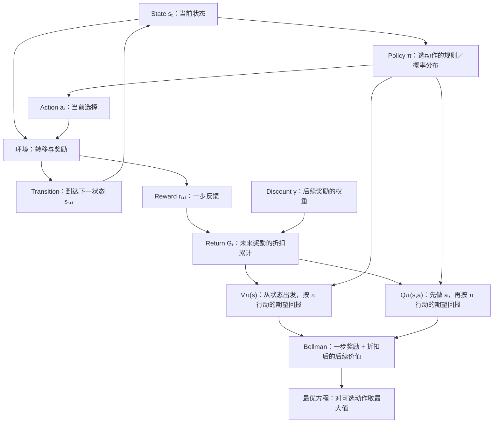

# RL 一页概念图

**日期：2026-10-12｜主线：交互 → 回报 → 策略评价 → 最优选择**

## 核心定义与递推

| 概念 | 定义／关系 |
|---|---|
| State | 决策所需的环境状态；满足马尔可夫性时，给定当前状态与动作，下一步分布不再依赖更早历史。相机观测不一定等于完整状态。 |
| Action / transition | 动作为选择；转移模型为 P(s′\|s,a)。一次采样转移可记为 (s,a,r,s′)。 |
| Reward / discount / return | reward 是一步反馈；γ 是折扣因子；Gₜ = rₜ₊₁ + γrₜ₊₂ + … = rₜ₊₁ + γGₜ₊₁。 |
| Policy | π(a\|s)：在状态 s 选择动作 a 的概率；确定性策略可写成 a = π(s)。策略不是一条已发生轨迹。 |
| V / Q | Vπ(s) = Eπ[Gₜ\|sₜ=s]；Qπ(s,a) = Eπ[Gₜ\|sₜ=s,aₜ=a]。Q 的首个动作可以不同于策略通常的选择。 |
| Bellman 策略评价 | Qπ(s,a) = E[r + γVπ(s′)\|s,a]；Vπ(s) = Σₐπ(a\|s)Qπ(s,a)。 |
| Bellman 最优关系 | Q*(s,a) = E[r + γV*(s′)\|s,a]；V*(s) = maxₐ Q*(s,a)。有限、折扣、全可观测 MDP 中的标准最优关系。 |

**Bellman 在做什么？** 把长期评价拆为“一步 + 后续”，建立不同状态价值之间的关系。评价指定策略时按 π 加权；寻找最优策略时比较动作价值。随机环境需要取期望，不等于预知某条未来轨迹。

## 今日独立手算：三状态确定性 MDP

γ = 0.5；G 为终止状态，V*(G) = 0。到达 G 时的奖励计入该次转移，不重复计入 G 的后续价值。

| 当前状态 | 动作 | 下一状态 | 奖励 | Q* |
|---|---|---|---:|---:|
| A | 直接到 G | G | 2 | 2 + 0.5 × 0 = **2** |
| A | 先到 B | B | 1 | 1 + 0.5 × 3 = **2.5** |
| B | 到 G | G | 3 | 3 + 0.5 × 0 = **3** |

- **V*(B) = 3；V*(A) = max(2, 2.5) = 2.5。**
- **最优策略：A 选“先到 B”；B 选“到 G”。**
- 用户已正确给出上述四个价值数值，并独立确认最优路径为 A → B → G。

**边界提醒：** return 是沿实际轨迹计算的累计奖励；V/Q 是策略下的期望回报。RLDS 是数据格式，存在 reward 字段不等于正在使用强化学习算法；Bellman 也不等于动作 token 解码。

## 实现与验证补充

- 用户完成三状态教学环境 `step(state, action)` 的转移输出验证。
- 用户完成固定采样 Q 更新，再改为 ε-greedy 的多回合表格 Q-learning。
- 用户报告训练结果：Q(A,直接到G)=2.0，Q(A,先到B)=2.499786376953125，Q(B,到G)=2.9999771118164062，与手算最优值接近。
- 已讲解 TD 目标 `r + γ max Q(s′,a′)`、学习率 α 与折扣 γ、探索与利用、终止时目标仅为 r。
- 用户确认完成冻结 Q、关闭探索的贪心策略评估；未提供本轮评估输出，未独立复核其结果。
- 区分训练估计 Q 与实际评估轨迹的折扣回报。当前教学环境的最优路径 A → B → G，实际折扣回报 1 + 0.5 × 3 = 2.5。

**当前完成范围：** 基础概念、确定性 MDP 手算、Bellman 一步递推、表格 Q-learning 训练与评估练习。随机转移的期望计算、函数逼近和深度 RL 不在今日完成范围。
